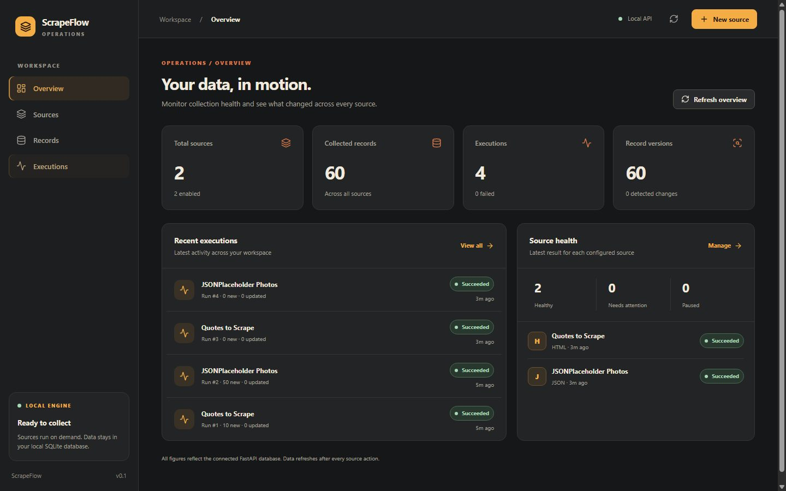

# ScrapeFlow

ScrapeFlow is a local data collection and monitoring app for public HTML pages and JSON APIs.



The dashboard above uses records collected from the two bundled public examples. See the [Sources](docs/screenshots/sources.jpg), [Records](docs/screenshots/records.jpg), and [Execution History](docs/screenshots/executions.jpg) views.

## Key capabilities

- Configure sources, run collections on demand, and inspect source health in a React dashboard.
- Extract HTML items with CSS selectors or JSON arrays and fields with object paths.
- Normalize records into a shared model. A source's external ID takes priority; otherwise its normalized record URL provides stable identity.
- Repeating a run leaves unchanged records alone. Changed content creates a new `RecordVersion`.
- Audit every execution through persisted status, counters, timestamps, and stage logs, including failures.
- Explore records by source, browse backend pages, search the loaded page, and inspect version history.

## Supported ingestion types

| Type | Configuration | Bundled example |
| --- | --- | --- |
| HTML | Item CSS selector and per-field CSS selectors/attributes | [Quotes to Scrape](examples/quotes.json) |
| JSON API | Array `items_path` and per-field object paths | [JSONPlaceholder Photos](examples/photos.json) |

Sources are configuration data, not scripts. The engine fetches static responses and runs manually through the API or dashboard.

## Architecture overview

The React client calls FastAPI's `/api/v1` endpoints. A synchronous pipeline validates the source URL, fetches a bounded response, extracts HTML or JSON items, normalizes fields, checks identity and content hashes, and commits records, versions, runs, and logs with SQLAlchemy to SQLite. See the [architecture diagram and data flow](docs/ARCHITECTURE.md).

## Technology stack

Python 3.12+, FastAPI, HTTPX, Beautiful Soup, SQLAlchemy, SQLite; React, TypeScript, Vite, Tailwind CSS, and Lucide. Pytest and Vitest provide offline automated tests.

## Quick Start

Run these commands from the repository root with Python 3.12+ and Node.js/npm installed:

```sh
python -m venv .venv
```

Install backend dependencies and start FastAPI on `127.0.0.1:8000`:

```sh
# Windows PowerShell
.\.venv\Scripts\python -m pip install -e ".[test]"
.\.venv\Scripts\python -m uvicorn scrapeflow.api:app --host 127.0.0.1 --port 8000
```

On Linux/macOS, use `./.venv/bin/python` for both commands. In another terminal, run:

```sh
cd frontend
npm ci
npm run dev
```

Open `http://127.0.0.1:5173/`. The Vite development server proxies `/api` to port 8000. The default database is `scrapeflow.db` in the backend working directory; set `SCRAPEFLOW_DATABASE_URL` to choose another SQLite file. [Platform-specific setup and database examples](docs/SETUP.md) cover PowerShell and Linux/macOS.

## Running the example sources

On **Sources**, select **Add Quotes** and **Add Photos**, then run each source. Registration alone does not collect data. Alternatively, with FastAPI on port 8000, run the one-time script:

```sh
# Windows PowerShell
.\.venv\Scripts\python examples/run_examples.py
```

Use `./.venv/bin/python examples/run_examples.py` on Linux/macOS. The script refuses duplicate source names if run again against the same database; repeat collections from the dashboard. These examples contact public websites and require network access.

## Tests and quality checks

```sh
# Backend, from repository root (use the venv Python for your platform)
.\.venv\Scripts\python -m pytest -q
.\.venv\Scripts\python -m compileall -q scrapeflow tests examples

# Frontend, from frontend/
npm run typecheck
npm test
npm run build
```

The automated suites use local fixtures; CI does not scrape public websites. [Phase 2 UAT evidence](docs/UAT_PHASE2.md) records the browser and API checks.

## Security and known limitations

Source URLs must use public HTTP(S) destinations on ports 80/443. The fetcher blocks redirects and resolved private/internal addresses, ignores environment proxies, and limits time and response size. DNS is checked before the HTTP client's own resolution, so this is **not complete DNS rebinding protection**; production deployments handling untrusted sources need network-level egress controls. Respect site access rules and collection rates.

Runs are synchronous. Record search covers only the currently loaded backend page, and large source/run histories have not been load-tested. SQLite schema changes currently require manual migration. The app does not support JavaScript-rendered scraping, PDF extraction, AI/RAG, authentication, or distributed scheduling.

## Future improvements

Server-side record search, scalable history pagination, database migrations, and stronger network isolation would be useful next steps. They are outside this MVP.

MIT licensed. See [LICENSE](LICENSE).
