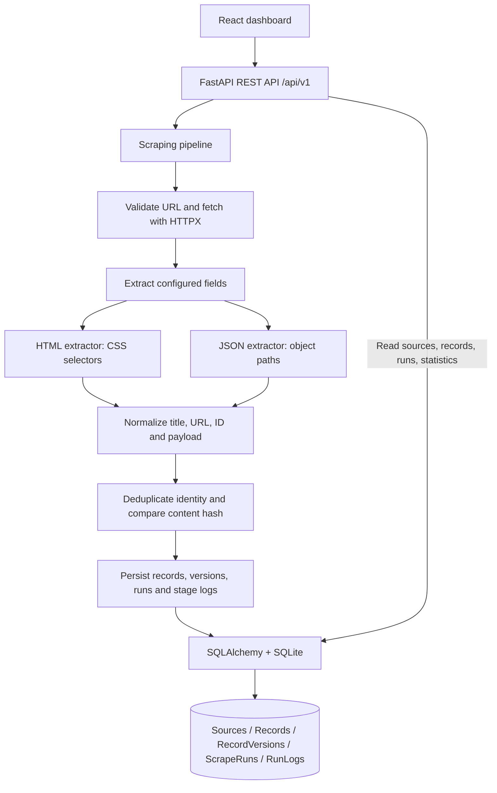

# ScrapeFlow architecture

ScrapeFlow is a modular monolith. The React dashboard calls FastAPI; an on-demand API request executes one source synchronously. SQLite stores source configuration and the audit trail. There is no queue or scheduler.

## Execution path

1. A source supplies a public URL, kind (`html` or `json`), extraction configuration, and enabled flag. Pydantic validates the configuration and URL on create and update.
2. A manual run is recorded before fetching. The fetcher uses HTTPX with a 10-second timeout, 2 MB response cap, no redirects, and no environment proxy routing.
3. HTML extraction uses a configured `item_selector` and per-field CSS selectors/attributes. JSON extraction reads an array at `items_path` (`$` for a top-level array) and configured dot-separated object paths.
4. Normalization requires title and URL, resolves relative URLs, and builds identity from `external_id` when present or the normalized record URL otherwise. Extra fields become payload.
5. The pipeline rejects duplicate identities within one response. For each existing identity, it compares a hash of canonical content. Unchanged content adds no version; changed content updates the record and appends a `RecordVersion`.
6. SQLAlchemy commits the results and a completed run. A failed stage rolls back partial record changes, marks the persisted run failed, and writes a stage-specific `RunLog`. Zero extracted records fail by default; `allow_empty: true` explicitly permits intentional emptiness.

List endpoints expose sources, records, runs, and statistics. Record versions and run logs have dedicated detail endpoints. The dashboard reads these persisted values; it does not generate demo metrics.

## Storage and limits

SQLite tables are created on startup. The database URL defaults to `sqlite:///scrapeflow.db` relative to the backend working directory and can be overridden with `SCRAPEFLOW_DATABASE_URL`. Schema migration automation is not included. Runs are synchronous; large histories and server-side record search are outside this MVP.

URL validation blocks internal/private resolved addresses and accepts public HTTP(S) destinations on ports 80/443. The client resolves the hostname again when connecting, so a DNS change between validation and connection is possible. Network-level egress controls are required for deployments that accept untrusted URLs.
